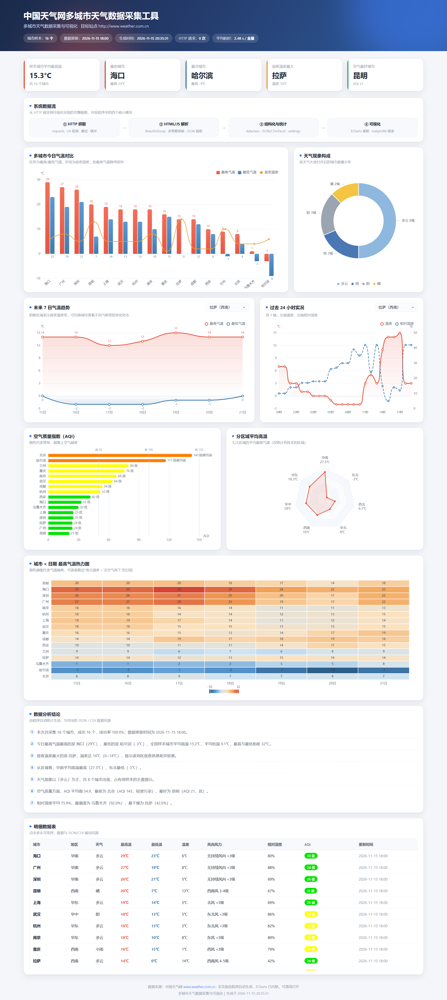

# weather-spider

> 中国天气网（weather.com.cn）多城市天气数据采集工具 —— 抓取、解析、统计、可视化一条龙。

一个用 `requests` + `BeautifulSoup` 写的轻量抓取工具：输入城市名，输出结构化的天气数据
（温度、天气现象、风向风力、7 日预报、24 小时实况），并可一键生成统计图表与交互式看板。



---

## 特性

| | |
|---|---|
| **多城市批量抓取** | 内置 36 个城市代码表，默认抓取 16 个，支持并发 |
| **字段丰富** | 今日昼夜预报、7 日逐日预报、3 小时预报序列、24 小时实况（温度/湿度/AQI/风向） |
| **页内 JSON 抽取** | 站点把部分数据写在 `<script>` 里，用括号配平法精确截取，不依赖正则 |
| **抗改版解析** | 四级策略级联，任一策略命中即返回；站点改版时自动降级而不是崩溃 |
| **编码纠错** | 四级回退（响应头 → meta → UTF-8 → GB18030），告别乱码 |
| **礼貌抓取** | 随机 UA、请求限速、指数退避重试、TTL 缓存、robots.txt 检查 |
| **多格式输出** | 终端表格、JSON、CSV、Excel、PNG 图表、单文件 HTML 看板 |
| **离线可复现** | 默认缓存原始 HTML，断网也能重跑全流程 |
| **有测试** | 24 个离线单元测试，用真实 HTML 快照验证解析逻辑 |

---

## 快速开始

```bash
git clone https://github.com/yyf1117520/weather-spider.git
cd weather-spider
pip install -r requirements.txt

# 抓取默认 16 个城市，并生成图表与看板
python main.py --charts --dashboard
```

跑完会在 `data/` 下得到结构化数据，`docs/figures/` 下得到 8 张图表，
根目录得到 `可视化看板.html`（双击即可打开，ECharts 已内联，无需联网）。

### 常用命令

```bash
python main.py --cities 北京 上海 广州     # 指定城市
python main.py --all                      # 全部 36 个城市
python main.py --top 8                    # 前 8 个城市
python main.py --fresh                    # 忽略缓存，强制联网
python main.py --offline                  # 只用本地缓存，断网演示
python main.py --export-xlsx              # 额外导出 Excel

python -m unittest discover -s tests -v   # 运行单元测试
```

### 参数说明

| 参数 | 说明 | 默认 |
|---|---|---|
| `--cities A B C` | 指定城市名，也接受 9 位城市代码 | 内置 16 城 |
| `--all` / `--top N` | 全部城市 / 前 N 个城市 | — |
| `--workers N` | 并发线程数 | 5 |
| `--delay S` | 请求间隔秒数 | 0.6 |
| `--timeout S` | 读取超时 | 15 |
| `--fresh` | 忽略缓存强制联网 | 关闭 |
| `--offline` | 只用缓存，不联网 | 关闭 |
| `--charts` | 生成 matplotlib 图表 | 关闭 |
| `--dashboard` | 生成单文件 HTML 看板 | 关闭 |
| `--export-xlsx` | 导出 Excel | 关闭 |
| `--brief` | 精简输出 | 关闭 |
| `--no-color` | 关闭彩色输出 | 关闭 |

---

## 输出

```
data/
├── weather.json        完整嵌套结构 + 元信息（看板与分析的数据源）
├── weather.csv         每城市一行，Excel 可直接打开（utf-8-sig）
├── weather_7d.csv      城市 × 日期的 7 日长表
├── weather.xlsx        三张工作表：汇总 / 7 日预报 / 24 小时实况
└── raw/                原始 HTML 缓存，支持离线复现
```

终端里长这样：

```
┌────────┬──────┬──────┬──────┬──────┬──────┬─────────────────┬──────┬──────────┐
│  城市  │ 地区 │ 天气 │ 最高 │ 最低 │ 温差 │    风向风力     │ 湿度 │   AQI    │
├────────┼──────┼──────┼──────┼──────┼──────┼─────────────────┼──────┼──────────┤
│ 海口   │ 华南 │ 多云 │ 29℃ │ 23℃ │  6℃ │ 无持续风向 <3级 │  78% │    35 优 │
│ 广州   │ 华南 │ 多云 │ 27℃ │ 19℃ │  8℃ │ 无持续风向 <3级 │  79% │    20 优 │
│ 北京   │ 华北 │ 小雨 │  8℃ │  4℃ │  4℃ │ 东风 <3级       │  72% │ 137 轻度 │
└────────┴──────┴──────┴──────┴──────┴──────┴─────────────────┴──────┴──────────┘
```

---

## 项目结构

```
weather-spider/
├── main.py                 命令行入口
├── config.py               城市代码表与全局配置
├── spider/
│   ├── models.py           dataclass 数据模型与派生指标
│   ├── http_client.py      HTTP 抓取（会话/重试/缓存/限速/编码）
│   ├── parser.py           HTML 与页内 JSON 解析
│   ├── pipeline.py         并发调度与失败隔离
│   ├── storage.py          JSON / CSV / Excel 持久化
│   ├── analyzer.py         统计分析
│   ├── visualizer.py       matplotlib 图表
│   ├── dashboard.py        单文件 HTML 看板
│   ├── ui.py               终端表格与颜色
│   └── logger.py           日志
├── tools/                  辅助脚本（截图、架构图）
├── tests/                  离线单元测试 + HTML 快照
├── data/                   抓取结果
├── docs/figures/           图表
└── vendor/echarts.min.js   看板用的前端库
```

---

## 实现要点

### 1. 四级策略级联解析

站点近几年改版过数次，早期版本的 `div.todayLeft` / `div.todayRight` 早已不存在。
解析器按优先级依次尝试四种定位方式，命中即返回，全失败只记告警：

```
A  新版 #today div.t > ul > li      ← 现行页面
B  #today 内任意 li（层级微调）
C  div.todayLeft / div.todayRight   ← 旧版页面
D  #7d 七日列表首日                 ← 只拿到 7 天页时的兜底
```

### 2. 页内 JSON 抽取

24 小时实况和 3 小时预报以 JS 对象字面量形式写在 `<script>` 里。
用贪婪正则会跨脚本误匹配，用非贪婪正则会在大括号出现在字符串中时提前截断，
所以这里用**括号配平 + 字符串状态机**精确截取，再交给 `json.loads`：

```python
data = extract_js_object(html, "observe24h_data")
```

### 3. 编码纠错

响应头没有 `charset` 时，requests 会按 HTTP/1.1 默认的 ISO-8859-1 解码，
中文于是变成乱码。`_decode()` 按 响应头 → `<meta charset>` → UTF-8 → GB18030
的顺序逐个尝试，并且显式跳过 requests 的默认猜测值。

### 4. 礼貌抓取

```
随机 UA  ·  请求间隔 0.6~1.2s  ·  TTL 缓存 1h  ·  429/5xx 指数退避重试
```

`robots.txt` 里禁用的路径直接跳过，不做任何绕过。

---

## 数据字段

`observe24h_data` 的字段是两位短码，站点没有公开文档，下表由交叉验证得到：

| 字段 | 含义 | 字段 | 含义 |
|---|---|---|---|
| `od0` | 观测时间戳 | `od24` | 风向名称 |
| `od1` | 城市名 | `od25` | 风力等级 |
| `od21` | 小时 | `od26` | 降水量 mm |
| `od22` | 温度 ℃ | `od27` | 相对湿度 % |
| `od23` | 风向角度 | `od28` | 空气质量指数 AQI |

> 注：AQI 常常比温度晚一个小时公布，当前整点的 `od28` 可能为空。
> 工具会自动回退到最近一个有值的整点。

---

## 免责声明

本项目仅用于学习与技术研究。使用时请遵守目标网站的 `robots.txt` 与服务条款，
控制请求频率，不要用于商业用途或大规模数据采集。抓取到的数据版权归原网站所有。

## License

[MIT](LICENSE)
